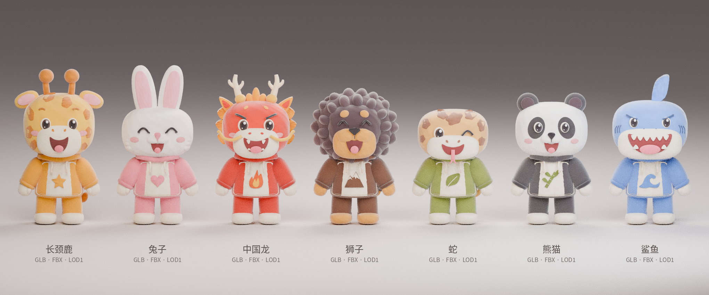

# Animal Companions 3D



依据你提供的七角色正面参考图，在本地 Blender 中制作的风格化静态角色。
角色分别为长颈鹿、兔子、中国龙、狮子、蛇、熊猫和鲨鱼。

## 文件

| 路径 | 内容 |
|---|---|
| `models/glb/` | 7 个独立 GLB；每个约 3 万三角面；贴图已内嵌，可单独复制 |
| `models/lod1/` | 7 个减面 GLB；每个约 1.1 万三角面；贴图已内嵌 |
| `models/fbx/` | 7 个 FBX；使用 `textures/` 中的共享贴图 |
| `textures/` | 1024×1024 的颜色、切线空间法线和 ORM 图集 |
| `source/Animal_Companions.blend` | 可编辑源文件，角色分组并保留头部、服装、表情和徽章等部件；贴图已打包 |
| `source/build_characters.py` | 可复现的本地建模/导出脚本，使用 Blender 4.3.2 制作 |
| `previews/` | 从导出 GLB 重新导入后渲染的正面、斜侧面及背面检查图 |
| `asset_manifest.json` | 各角色的面数、尺寸和坐标说明 |
| `validation_report.json` | GLB 文件和几何数据检查结果 |

`01_giraffe` = 长颈鹿；`02_rabbit` = 兔子；`03_dragon` = 中国龙；`04_lion` = 狮子；
`05_snake` = 蛇；`06_panda` = 熊猫；`07_shark` = 鲨鱼。

## 导入游戏引擎

- **Godot**：可直接导入 GLB。
- **Unity**：可选 FBX；导入时保留 `models/` 与 `textures/` 的相对路径。GLB 需项目已有 glTF 导入器，例如 glTFast。
- **Unreal**：可选 FBX 并指定共享贴图；GLB 需要对应 glTF/Interchange 导入支持。
- **Blender**：直接打开 `.blend` 编辑，或单独导入 GLB / FBX。

单位为米，各角色按参考图保持不同身高，约 1.36–1.88 米。GLB 的 +Y 为向上、+Z 为正面；Blender 源文件为 Z 向上、-Y 为正面。每个导出角色的原点在双脚之间的地面。可以在引擎中整体缩放。

GLB 每角色为单一合并网格、单一 PBR 材质。LOD1 是独立文件，需要在目标引擎中手动配置 LOD 距离。它们不包含碰撞体。

FBX 在不同引擎中可能不会自动还原粗糙度图集的通道连接；请按下方材质说明手动指定。GLB 已包含相应 PBR 连接。

## 材质

- `plush_basecolor.png`：sRGB 颜色图集。
- `plush_normal.png`：OpenGL / +Y 切线空间法线，按非颜色数据导入；若目标引擎要求 DirectX 法线，请翻转绿色通道。
- `plush_orm.png`：R = 1（未烘焙遮挡），G = 粗糙度，B = 0（金属度）；按非颜色数据导入。Unity 的平滑度通常需由 1 − 粗糙度转换。

UV 采用共享调色图集，同色部件会复用图集区域。这不是用于逐部件独立手绘的唯一 UV；若后续需要专属皮肤贴图，可在源文件中重新展开并烘焙。

## 角色状态

这是**静态模型**，没有骨骼、蒙皮、表情形态键或动作动画。若要让角色走路、跳跃或攻击，需要继续做骨骼绑定、权重和动画。

模型是根据单张正面图进行的风格化重建，并非恢复原图的原始 3D 工程。背面、服装后侧和尾巴是补充设计；毛绒质感以立体造型与贴图近似，不含高成本毛发系统。部件之间保留了适合静态角色的重叠结构；进一步绑定时可在 `.blend` 内分部件调整。

制作和导出在本地完成，未使用云端 3D 生成服务。

## 重新生成

使用 Blender 4.3 或更新版本，在终端执行：

```bash
blender -b --python source/build_characters.py -- --skip-render
```

脚本会在 `source/generated_assets/` 生成新文件，不覆盖本包原模型。也可从 Blender 的文本编辑器运行；脚本中包含基本的工作室布光。
